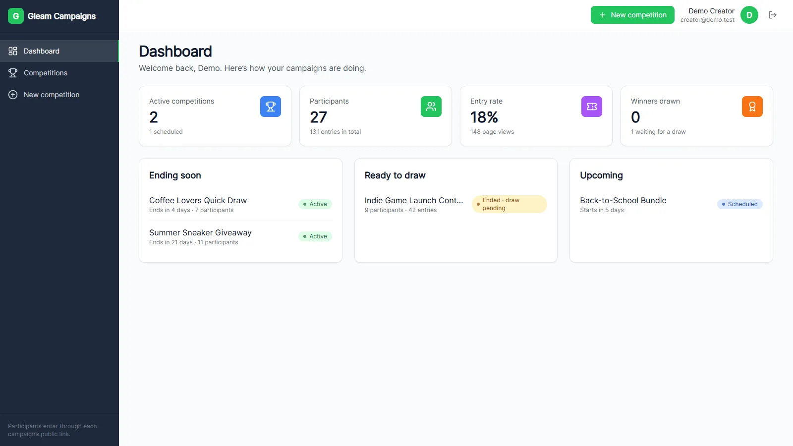
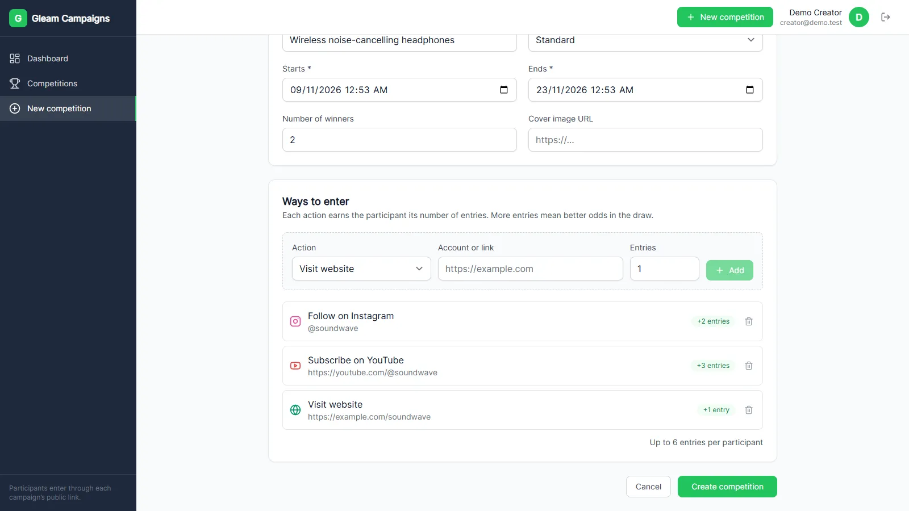
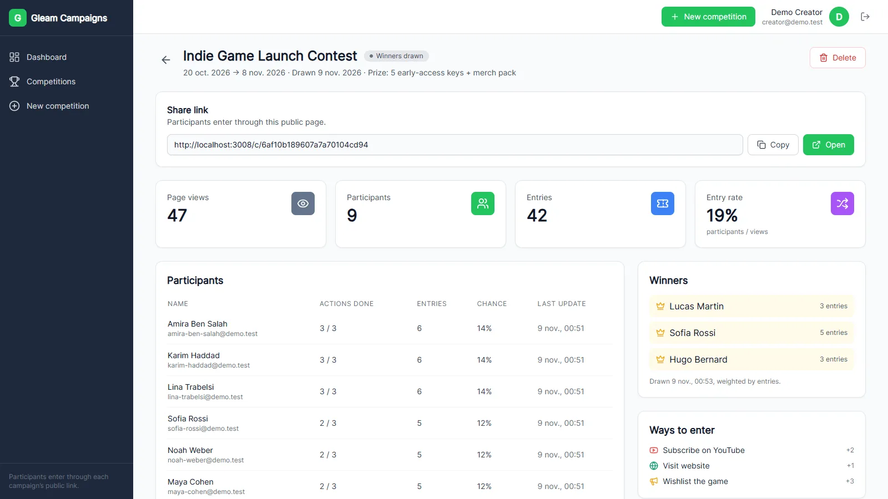
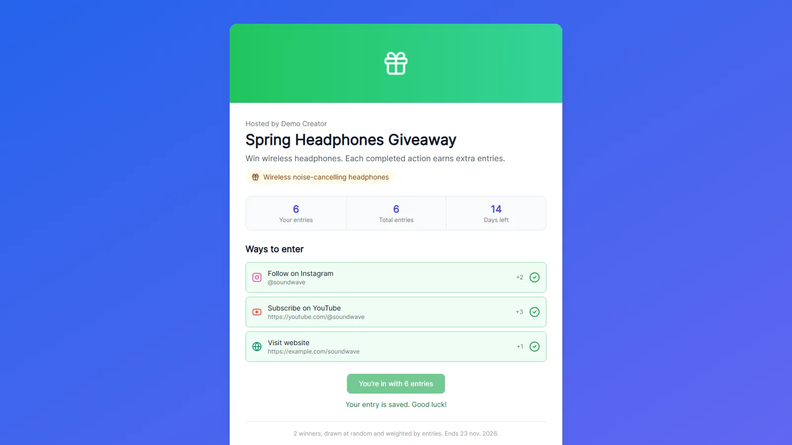

# Gleam Campaigns

A giveaway platform in the style of [Gleam.io](https://gleam.io). Brands build a campaign from social actions, each worth a number of entries, and share one link. Participants complete the actions to collect entries, and when the campaign ends the creator draws the winners in a lottery weighted by entries.

Built with **React, Express and MongoDB**.



## Features

**For creators**
- Sign up and sign in (bcrypt-hashed passwords, JWT sessions)
- Campaign builder: title, description, prize, type, dates, number of winners, cover image
- Six action types: Instagram follow, X follow, YouTube subscribe, website visit, post share, custom task. Each one is worth 1–100 entries.
- Public share link for each campaign
- Dashboard: active campaigns, participants, entry rate (participants ÷ page views), campaigns waiting for a draw
- Campaign list with status tabs (active, scheduled, to draw, drawn) and search
- Manage page: page views, participants with their entries and chance of winning, the action list, and delete
- **Winner draw**: weighted random selection without replacement, so nobody can win twice. Early draws need confirmation, and the result is stored and shown publicly.

**For participants**
- Public campaign page that works without an account until the participant enters
- "Do it" opens the account or link in a new tab and ticks the action
- Ticked actions survive the sign-in redirect
- One entry per person: entering again updates the existing entry instead of adding a second one
- Winners are shown on the page once they have been drawn

| Build a campaign | Draw winners | Participant page |
| --- | --- | --- |
|  |  |  |

## Stack

| Layer | Technology |
| --- | --- |
| Client | React 18, React Router 6, Vite 5, Tailwind CSS 3, lucide-react |
| API | Node.js 18+, Express 4 |
| Data | MongoDB with Mongoose 6 |
| Auth | JWT (jsonwebtoken), bcryptjs |
| Tests | Node's built-in test runner (`node:test`) |

## Getting started

Prerequisites: Node.js 18 or newer, and MongoDB running locally (or a MongoDB Atlas URI).

```bash
npm install
cp .env.example .env      # set JWT_SECRET; adjust MONGO_URI if needed
npm run seed              # optional: fictional demo data
npm start                 # API on :3009, web app on :3008
```

Open http://localhost:3008. After `npm run seed` you can sign in as `creator@demo.test` / `demo-pass-123`. Seeded participants use `<name>@demo.test` with the same password, for example `amira-ben-salah@demo.test`. These accounts are local demo data only.

| Script | What it does |
| --- | --- |
| `npm start` | API (with `--watch`) and the Vite dev server together |
| `npm run server` / `npm run dev` | API only / web app only |
| `npm run seed` | Wipes the local database and loads demo campaigns, users and entries |
| `npm test` | Unit tests for validation, entry counting and the draw |
| `npm run build` | Production build of the web app into `dist/` |

### Environment variables

| Variable | Default | Purpose |
| --- | --- | --- |
| `PORT` | `3009` | API port |
| `MONGO_URI` | `mongodb://127.0.0.1:27017/gleam` | MongoDB connection string |
| `JWT_SECRET` | dev-only fallback | Token signing secret. **Required** when `NODE_ENV=production`. |
| `JWT_EXPIRES_IN` | `7d` | Token lifetime |
| `CLIENT_URL` | `http://localhost:3008` | Public web-app URL, used for share links and CORS in production |
| `VITE_API_URL` | *(same origin)* | Build-time API base URL for the web app, when the API is hosted elsewhere |

## Architecture

```
src/                     React app
  pages/                 Dashboard, Competitions, CreateCompetition, ManageCompetition,
                         CampaignPage (public), Login, Register
  components/            Layout, Sidebar, Header, RequireAuth, shared UI
  lib/api.js             fetch wrapper: token, JSON, error shape
  context/AuthContext    session state
server/
  app.js                 Express app (routes, CORS, error handling)
  server.js              connects to MongoDB, then listens
  routes/ controllers/   HTTP layer
  models/                User, Competition (embedded actions, winners), Entry
  lib/competitionRules   validation, entry counting, weighted draw — no I/O, unit-tested
  middleware/            auth (required / optional), 404 and error handler
  seed.js                demo data
```

In development, Vite proxies `/api` to Express, so the browser only ever talks to one origin.

### API

| Method | Path | Auth | Description |
| --- | --- | --- | --- |
| POST | `/api/auth/register` | — | Create an account (always a regular user) |
| POST | `/api/auth/login` | — | Get a token |
| GET | `/api/auth/me` | user | Current user |
| GET | `/api/competitions` | user | Your competitions (`?status=active\|scheduled\|ended\|drawn`) |
| POST | `/api/competitions` | user | Create |
| GET | `/api/competitions/:id/manage` | owner | Full document for its creator |
| PATCH | `/api/competitions/:id` | owner | Edit; actions are locked once someone has entered |
| DELETE | `/api/competitions/:id` | owner | Delete the competition and its entries |
| GET | `/api/competitions/:id/entries` | owner | Participant list |
| POST | `/api/competitions/:id/draw` | owner | Draw winners (`{ "early": true }` while still running) |
| GET | `/api/competitions/:id` | optional | Public campaign data, plus your own entry when signed in |
| POST | `/api/competitions/:id/view` | — | Count a page view |
| POST | `/api/competitions/:id/enter` | user | Enter or update your entry: `{ "completedActions": [actionId] }` |

Errors come back as `{ "message": "…", "errors": ["…"] }` with a matching HTTP status.

### Design decisions

- **The server counts entries.** The client sends only the ids of the actions it completed. The API ignores unknown or repeated ids and adds up the points itself, so a participant can't award themselves extra entries.
- **One entry document per participant.** A unique `(competition, user)` index makes re-entering an update. The campaign's participant and entry totals are recomputed from the entries, so they can't drift.
- **Fair draw.** Winners are drawn with `crypto.randomInt`, weighted by entries and without replacement. The draw happens once, and the result is stored.
- **Ownership checks on every management route.** Only a campaign's creator (or an admin) can see its participants, edit it, draw it or delete it. A creator can't enter their own campaign.
- **Business rules have no dependencies.** Validation, entry counting and the draw live in `server/lib/competitionRules.js`, which has no Express or MongoDB imports, so they are unit-tested directly.

## Limitations

- **Actions are self-reported.** Ticking "Follow on Instagram" opens the account, but the platform does not check with Instagram, X or YouTube that the follow happened. Checking would need each network's official API and OAuth.
- No email notifications to winners yet, and no image upload (the cover image is a URL).
- Entry fees and payments are not implemented.

## History

The first version was built during a two-month engineering internship at Krenova Consulting in summer 2025. The first commit in this repository is that code as delivered. Later commits fix its bugs and add per-participant entries, the winner draw, ownership checks, validation, tests and this documentation.
